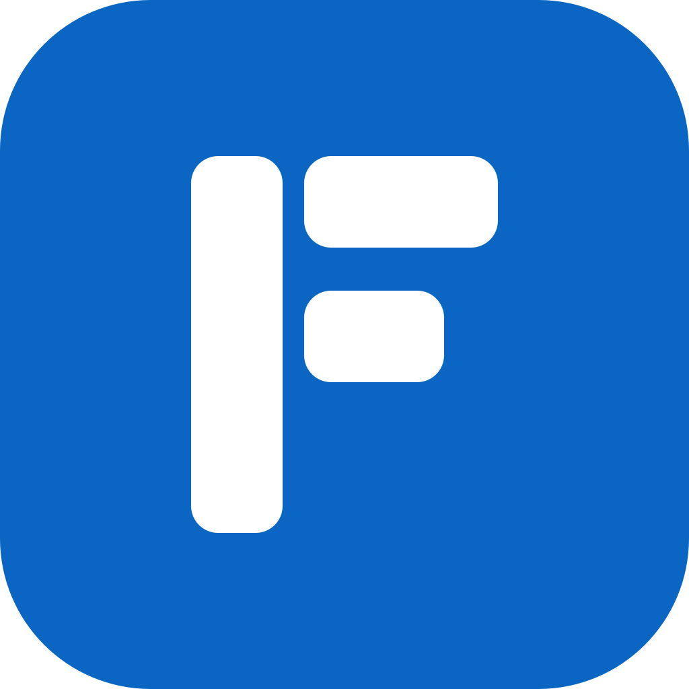

<p align="center"></p>

# Findy

**A free, open-source desktop app to track your job search.**

[Українською](README.uk.md)

> 🚧 **Status: pre-alpha.** The MVP is being specified — see
> [specs/001-mvp-board](specs/001-mvp-board/spec.md). No release yet.

Sending dozens of applications and losing track of which company is at which
stage? Findy keeps every application on a single board, from the moment you
apply until you get an offer.


## Features

- **Kanban board of your job search.** Every application is a card; columns are
  the stages of a hiring process:

  `Applied` → `HR interview` → `Test task` → `Technical interview` →
  `C-level interview` → `Offer` / `Rejected`

- **Quick add.** Job title, company and a link to the vacancy, and that's it.
- **Drag and drop** cards between stages (keyboard works too).
- **Notes on every application.** Who you talked to, salary discussed, next steps.
- **One click to the vacancy.** Cards with a link open it in your browser.
- **Details panel.** Edit an application and see its stage history as a timeline.
- **Stage history.** Each card shows how long it has been in its stage.
- **English and Ukrainian** interface, **light and dark** theme.
- **Start over.** Reset the board in one step; Findy keeps a backup first.
- **Private by design.** Works offline, no account, no telemetry. Your data lives in a
  local SQLite database on your computer.
- **Windows, macOS and Linux.**

## Download

Installers will be published on the
[Releases](../../releases) page:

| OS | File |
|----|------|
| Windows 10/11 (x64) | `Findy-Setup-x.y.z.exe` |
| macOS (Apple Silicon) | `Findy-x.y.z-arm64.dmg` |
| macOS (Intel) | `Findy-x.y.z-x64.dmg` |
| Linux (x64) | `Findy-x.y.z.AppImage` or `findy_x.y.z_amd64.deb` |

Early builds are not code-signed:

- **macOS:** right-click the app → *Open*, or run
  `xattr -dr com.apple.quarantine /Applications/Findy.app`.
- **Windows:** on the SmartScreen prompt click *More info* → *Run anyway*.
- **Linux (AppImage):** `chmod +x Findy-*.AppImage` and run it.

## Run from source

Requirements: [Node.js](https://nodejs.org/) 22 LTS or newer, npm, Git.

```bash
git clone https://github.com/YuraBerez/findy.git
cd findy
npm install
npm run dev          # start the app with hot reload
```

Other commands:

| Command | What it does |
|---------|--------------|
| `npm run build` | Production build of the app code |
| `npm run dist` | Build an installer for your current OS into `dist/` |
| `npm test` | Unit tests |
| `npm run test:coverage` | Unit tests with the 80 % coverage gate |
| `npm run test:e2e` | End-to-end tests against the real app |
| `npm run lint` | Lint and type-check |

On Linux you may need the usual Electron system libraries
(`libgtk-3-0 libnss3 libasound2`); for building `.deb` packages also `fakeroot` and `dpkg`.

## Use Findy from Claude or another AI assistant (MCP)

Findy has a built-in [MCP](https://modelcontextprotocol.io) server, so an assistant can
add, move and annotate applications when you ask it to ("I applied to Acme as a
frontend developer", "move Globex to the technical interview").

1. In Findy open **⋯ → AI assistant access (MCP)…** and turn it on (it is off by default).
2. Copy the configuration it shows into your client:
   - **Claude Desktop / Cowork:** `claude_desktop_config.json` (Settings → Developer → Edit Config).
   - **Claude Code:** the `claude mcp add findy …` command from the same dialog.
   - **Gemini CLI, Cursor, VS Code, Windsurf, Zed, Codex CLI…:** the command, arguments
     and environment (`ELECTRON_RUN_AS_NODE=1`) from the dialog, transport stdio.
     The short form `<Findy> --mcp` also works.

Tools: list and get applications, list stages, add, update, move, add a note,
delete (the assistant asks you first). The same rules apply as in the app, and an
open Findy window shows the changes within a second.

**Privacy:** Findy itself makes no network requests. The assistant you connect sends
what it reads to its AI provider, and only when you ask it to work with your board.

## Where is my data?

| OS | Path |
|----|------|
| Windows | `%APPDATA%\Findy\findy.db` |
| macOS | `~/Library/Application Support/Findy/findy.db` |
| Linux | `~/.config/Findy/findy.db` |

It is a standard SQLite database: back it up to keep your board, or open it
with any SQLite tool. The schema is documented in
[docs/contracts/database.md](docs/contracts/database.md).

## Contributing

Contributions are welcome: code, translations, bug reports, ideas.
Start with [CONTRIBUTING.md](CONTRIBUTING.md).

## License

[MIT](LICENSE)
