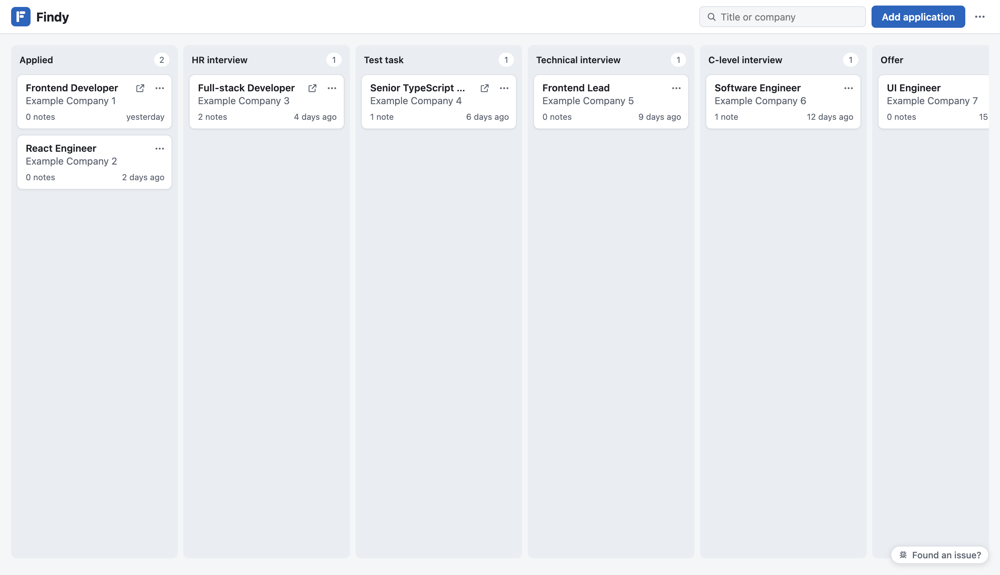
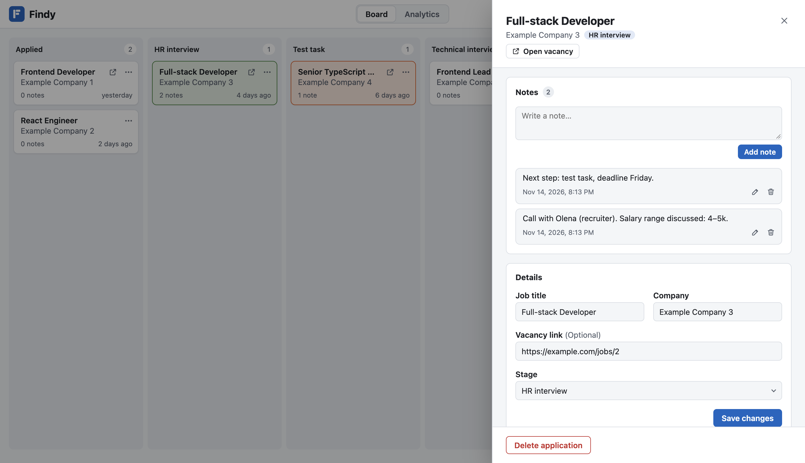
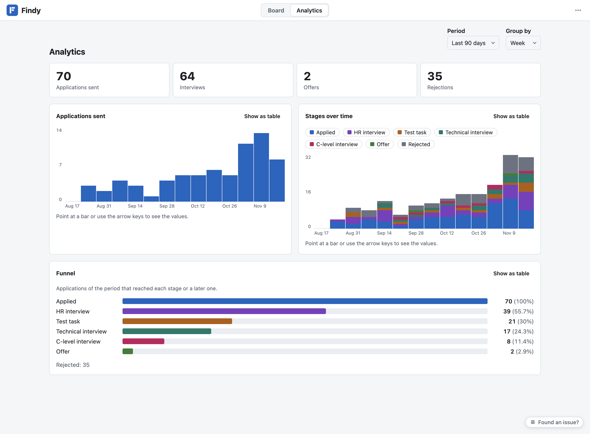
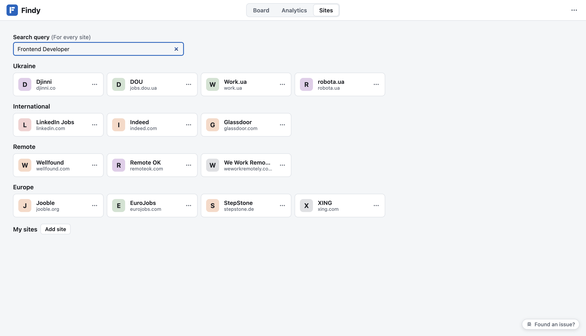

<p align="center"></p>

# Findy

**A free, open-source desktop app to track your job search.**

[Українською](README.uk.md)

[](https://ko-fi.com/findyapp)

> **Status: 0.6.1.** Download it from
> [Releases](https://github.com/YuraBerez/findy/releases). Feedback is welcome: use the
> *Found an issue?* button in the app.

Sending dozens of applications and losing track of which company is at which
stage? Findy keeps every application on a single board, from the moment you
apply until you get an offer.

[](https://www.youtube.com/watch?v=6CEthFABoIE)









## Features

- **Kanban board of your job search.** Every application is a card; columns are
  the stages of a hiring process:

  `Applied` → `HR interview` → `Test task` → `Technical interview` →
  `C-level interview` → `Offer` / `Rejected`

- **Quick add.** Job title, company and a link to the vacancy, and that's it.
- **Drag and drop** cards between stages (keyboard works too).
- **Notes on every application.** Who you talked to, salary discussed, next steps.
- **Salary, work format and contact.** Keep the salary range, remote/office/hybrid, the
  location, the source and the recruiter on each application. The card shows the work
  format and the salary. The source fills in from a job site link.
- **Next step and reminders.** Give an application its next step with a date and a time.
  The card shows "Today", "Tomorrow" or "Overdue". While Findy runs, it reminds you 15
  minutes and 1 minute before the step. **Add to calendar** saves the step as an `.ics`
  file. On macOS, allow notifications for Findy in **System Settings → Notifications**.
- **One click to the vacancy.** Cards with a link open it in your browser.
- **Add from a link.** Paste a vacancy link and Findy fills in the job title and the
  company from the page.
- **Card colours.** Mark cards with one of 7 colours from the card's **⋯** menu.
- **No movement.** Cards that stay in a stage for more than 14 days (you choose the
  number) are marked, so you know where to follow up.
- **Details panel.** Edit an application and see its stage history as a timeline.
- **Stage history.** Each card shows how long it has been in its stage.
- **Analytics.** See how many applications you send per day, week or month, how many
  HR, technical and C-level interviews you get, and how far your applications go in a
  funnel. Every chart can also show its numbers as a table.
- **Update check.** **⋯ → Check for updates…** tells you when a new version is out.
  Turn on the automatic check in **⋯ → Settings…** if you want it (off by default).
- **CSV export and import.** Save the whole board to a file that opens in any
  spreadsheet, or add applications from your own table (**⋯ → Export to CSV…**,
  **Import from CSV…**). Import shows a summary first and never changes existing cards.
- **Job sites.** A **Sites** tab with 14 job sites (Djinni, DOU, Work.ua, LinkedIn,
  Indeed and more): type your search once and open it on any site in one click. Add
  your own sites and hide the ones you do not use.
- **English and Ukrainian** interface, **light and dark** theme.
- **Start over.** Reset the board in one step; Findy keeps a backup first.
- **One settings window.** **⋯ → Settings…** or Cmd/Ctrl+, opens the language, the theme,
  the columns, reminders, the update check and AI assistant access in one place.
- **Private by design.** Works offline, no account, no telemetry. Your data lives in a
  local SQLite database on your computer. Findy goes online only for what you ask:
  the update check (when you start it or turn it on), the vacancy page whose link you
  paste, and the icons of job sites (once each). None of these sends data about you or
  your board.
- **Windows, macOS and Linux.**

## Download

Installers are on the [Releases](https://github.com/YuraBerez/findy/releases) page:

| OS | File |
|----|------|
| Windows 10/11 (x64) | `Findy-Setup-x.y.z.exe` |
| Mac with Apple Silicon (M1, M2, M3, M4…) | `Findy-x.y.z-macOS-Apple-Silicon.dmg` |
| Mac with an Intel processor | `Findy-x.y.z-macOS-Intel.dmg` |
| Windows, portable (no install) | `Findy-x.y.z-Windows-portable.zip` |
| Linux (x64) | `Findy-x.y.z.AppImage` or `findy_x.y.z_amd64.deb` |

Findy needs macOS 13 Ventura or later, or Windows 10/11 (64-bit).

Homebrew, Scoop, how to check a download, and what to do on the first start (the builds
are not signed yet): [docs/guide/install.md](docs/guide/install.md).

## Run from source

See [CONTRIBUTING.md](CONTRIBUTING.md#development-setup).

## Use Findy from Claude or another AI assistant (MCP)

Findy has a built-in [MCP](https://modelcontextprotocol.io) server, so an assistant can
add, move and annotate applications when you ask it to ("I applied to Acme as a frontend
developer"). Access is off until you turn it on in **⋯ → Settings… → AI assistant**. How
to connect a client: [docs/guide/ai-assistant.md](docs/guide/ai-assistant.md).

## Install the Findy skill

The skill teaches your assistant how to work with your board. Claude Code installs it
with one command; steps for Claude Desktop and other assistants are in
[docs/guide/ai-assistant.md](docs/guide/ai-assistant.md#install-the-findy-skill).

macOS and Linux:

```bash
mkdir -p ~/.claude/skills/findy && curl -fsSL "https://raw.githubusercontent.com/YuraBerez/Findy/main/skills/findy/SKILL.md" -o ~/.claude/skills/findy/SKILL.md.tmp && mv ~/.claude/skills/findy/SKILL.md.tmp ~/.claude/skills/findy/SKILL.md
```

Windows (PowerShell):

```powershell
$d = "$HOME\.claude\skills\findy"; New-Item -ItemType Directory -Force $d | Out-Null; Invoke-WebRequest -UseBasicParsing "https://raw.githubusercontent.com/YuraBerez/Findy/main/skills/findy/SKILL.md" -OutFile "$d\SKILL.md.tmp"; if ($?) { Move-Item -Force "$d\SKILL.md.tmp" "$d\SKILL.md" }
```

## Where is my data?

| OS | Path |
|----|------|
| Windows | `%APPDATA%\Findy\findy.db` |
| macOS | `~/Library/Application Support/Findy/findy.db` |
| Linux | `~/.config/Findy/findy.db` |

It is a standard SQLite database: back it up to keep your board, or open it
with any SQLite tool. To get your applications as a table, use **⋯ → Export to CSV…**.
The schema is documented in
[docs/contracts/database.md](docs/contracts/database.md).

## Support Findy

Findy is free and stays free. The macOS builds are not notarised yet, because that
needs an Apple Developer membership ($99 a year); until then, macOS asks once on the
first start. If Findy helps your job search, you can
[support it on Ko-fi](https://ko-fi.com/findyapp): the first goal is that
membership, so Findy opens on a Mac without a warning.

## Contributing

Contributions are welcome: code, translations, bug reports, ideas.
Start with [CONTRIBUTING.md](CONTRIBUTING.md).

## License

[MIT](LICENSE)
