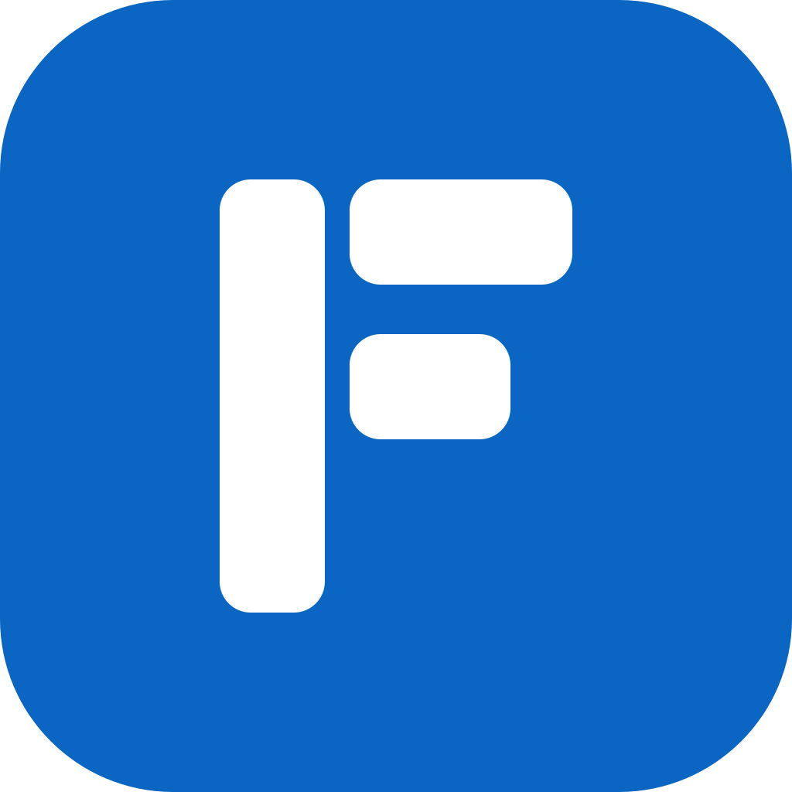
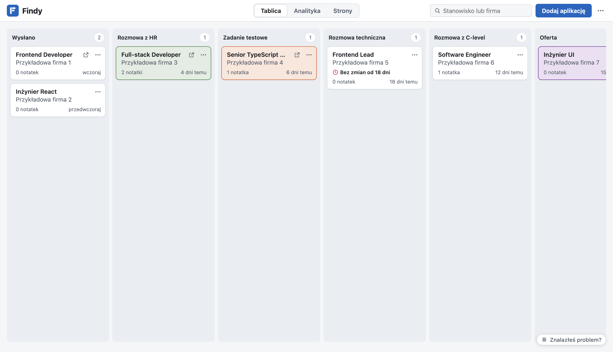
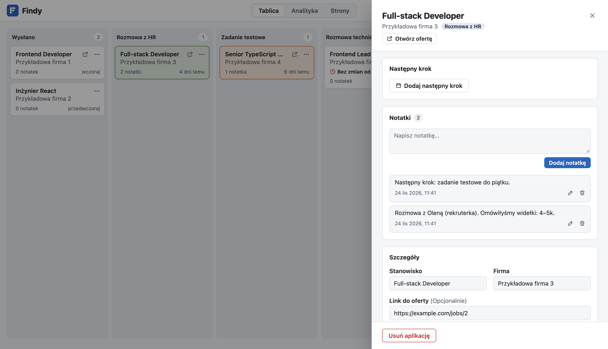
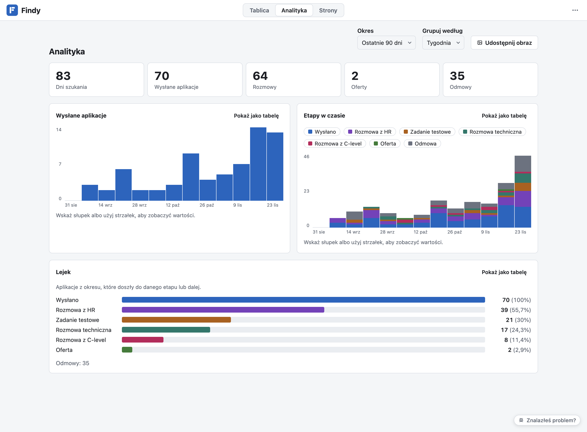
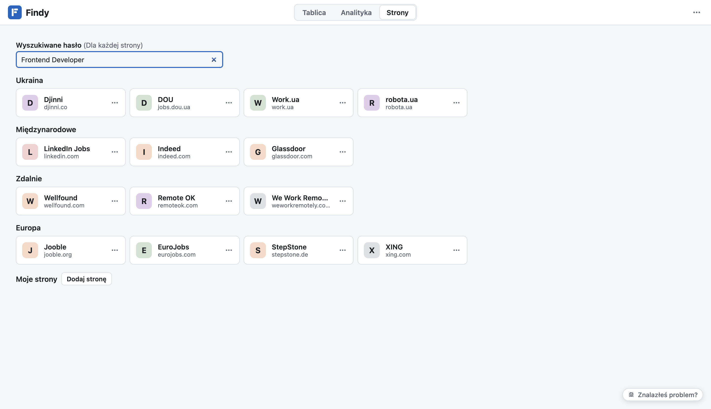

<p align="center"></p>

# Findy

**Darmowa aplikacja desktopowa o otwartym kodzie do śledzenia Twojego szukania pracy.**

**Strona:** [yuraberez.github.io/Findy/pl](https://yuraberez.github.io/Findy/pl/)

[English](README.md) · [Українською](README.uk.md)

[](https://ko-fi.com/findyapp)

> **Status: 0.9.0.** Pobierz Findy ze strony
> [Releases](https://github.com/YuraBerez/findy/releases). Chętnie poznamy Twoją opinię:
> użyj przycisku *Znalazłeś problem?* w aplikacji.

Wysyłasz dziesiątki aplikacji i nie pamiętasz już, na jakim etapie jesteś w której firmie?
Findy trzyma wszystkie aplikacje na jednej tablicy: od wysłania CV aż do oferty.

[](https://www.youtube.com/watch?v=6CEthFABoIE)









## Funkcje

- **Tablica kanban Twojego szukania pracy.** Każda aplikacja to karta, a kolumny to
  etapy rekrutacji:

  `Wysłano` → `Rozmowa z HR` → `Zadanie testowe` → `Rozmowa techniczna` →
  `Rozmowa z C-level` → `Oferta` / `Odmowa`

- **Szybkie dodawanie.** Stanowisko, firma i link do oferty, i gotowe.
- **Przeciąganie** kart między etapami (klawiatura też działa).
- **Notatki do każdej aplikacji.** Z kim rozmawiałeś, jakie wynagrodzenie omawialiście,
  co dalej.
- **Wynagrodzenie, forma pracy i kontakt.** Zapisz w każdej aplikacji widełki
  wynagrodzenia, pracę zdalną/biurową/hybrydową, lokalizację, źródło i rekrutera. Karta
  pokazuje formę pracy i wynagrodzenie. Źródło uzupełnia się samo z linku do strony z
  ofertami.
- **Następny krok i przypomnienia.** Dodaj do aplikacji następny krok z datą i godziną.
  Karta pokazuje „Dzisiaj”, „Jutro” lub „Zaległe”. Gdy Findy jest uruchomiony,
  przypomina Ci 15 minut i 1 minutę przed krokiem. **Dodaj do kalendarza** zapisuje krok
  jako plik `.ics`. Na macOS zezwól Findy na powiadomienia w **Ustawieniach systemowych →
  Powiadomienia**.
- **Jedno kliknięcie do oferty.** Karty z linkiem otwierają go w przeglądarce.
- **Dodawanie z linku.** Wklej link do oferty, a Findy uzupełni stanowisko i firmę ze
  strony.
- **Dodawanie z przeglądarki.** Rozszerzenie przeglądarki Findy dodaje otwartą ofertę
  jednym kliknięciem, także ze stron wymagających logowania
  ([jak zainstalować](docs/guide/browser-extension.pl.md)).
- **Kolory kart.** Oznacz kartę jednym z 7 kolorów w jej menu **⋯**.
- **Bez zmian.** Karty, które stoją na etapie dłużej niż 14 dni (liczbę wybierasz sam),
  są oznaczone, więc wiesz, gdzie warto się przypomnieć.
- **Panel szczegółów.** Edytuj aplikację i zobacz historię jej etapów na osi czasu.
- **Historia etapów.** Każda karta pokazuje, jak długo jest na swoim etapie.
- **Analityka.** Zobacz, ile aplikacji wysyłasz dziennie, tygodniowo lub miesięcznie, ile
  masz rozmów z HR, technicznych i z C-level oraz jak daleko docierają Twoje aplikacje w
  lejku. Każdy wykres może też pokazać swoje liczby w tabeli.
- **Sprawdzanie aktualizacji.** **⋯ → Sprawdź aktualizacje…** powie Ci, gdy wyjdzie nowa
  wersja. Automatyczne sprawdzanie możesz włączyć w **⋯ → Ustawienia…** (domyślnie
  wyłączone).
- **Eksport i import CSV.** Zapisz całą tablicę do pliku, który otworzysz w dowolnym
  arkuszu kalkulacyjnym, albo dodaj aplikacje z własnej tabeli (**⋯ → Eksportuj do
  CSV…**, **Importuj z CSV…**). Import najpierw pokazuje podsumowanie i nigdy nie zmienia
  istniejących kart.
- **Strony z ofertami pracy.** Karta **Strony** z 14 serwisami (Djinni, DOU, Work.ua,
  LinkedIn, Indeed i inne): wpisz zapytanie raz i otwórz je na dowolnej stronie jednym
  kliknięciem. Dodawaj własne strony i ukrywaj te, z których nie korzystasz.
- Interfejs **po angielsku, ukraińsku i polsku**, motyw **jasny i ciemny**.
- **Zacznij od nowa.** Wyczyść tablicę jednym krokiem; Findy najpierw zrobi kopię
  zapasową.
- **Jedno okno ustawień.** **⋯ → Ustawienia…** lub Cmd/Ctrl+, otwiera w jednym miejscu
  język, motyw, kolumny, przypomnienia, sprawdzanie aktualizacji i dostęp asystenta AI.
- **Prywatność od podstaw.** Działa offline, bez konta i bez telemetrii. Twoje dane są w
  lokalnej bazie SQLite na Twoim komputerze. Findy łączy się z internetem tylko wtedy, gdy
  o to poprosisz: sprawdzanie aktualizacji (gdy je uruchomisz lub włączysz), strona
  oferty, której link wklejasz, i ikony stron z ofertami (raz dla każdej). Żadne z nich
  nie wysyła danych o Tobie ani o Twojej tablicy.
- **Windows, macOS i Linux.**

## Pobieranie

Instalatory są na stronie [Releases](https://github.com/YuraBerez/findy/releases):

| System | Plik |
|----|------|
| Windows 10/11 (x64) | `Findy-Setup-x.y.z.exe` |
| Mac z Apple Silicon (M1, M2, M3, M4…) | `Findy-x.y.z-macOS-Apple-Silicon.dmg` |
| Mac z procesorem Intel | `Findy-x.y.z-macOS-Intel.dmg` |
| Windows, wersja przenośna (bez instalacji) | `Findy-x.y.z-Windows-portable.zip` |
| Linux (x64) | `Findy-x.y.z.AppImage` lub `findy_x.y.z_amd64.deb` |

Findy wymaga macOS 13 Ventura lub nowszego albo Windows 10/11 (64-bit).

Homebrew, Scoop, jak sprawdzić pobrany plik i co zrobić przy pierwszym uruchomieniu
(wersje nie są jeszcze podpisane): [docs/guide/install.pl.md](docs/guide/install.pl.md).

## Uruchamianie z kodu źródłowego

Zobacz [CONTRIBUTING.md](CONTRIBUTING.md#development-setup) (po angielsku).

## Dodaj ofertę z przeglądarki

Rozszerzenie przeglądarki Findy jednym kliknięciem dodaje ofertę, którą widzisz, do
Twojej tablicy, także ze stron wymagających logowania. Nie ma go jeszcze w sklepach
przeglądarek: jak zainstalować je z wydania i wczytać w Chrome, Edge, Brave, Opera,
Vivaldi lub Firefox, opisuje
[docs/guide/browser-extension.pl.md](docs/guide/browser-extension.pl.md).

## Findy z Claude lub innym asystentem AI (MCP)

Findy ma wbudowany serwer [MCP](https://modelcontextprotocol.io), więc asystent może
dodawać, przenosić i opisywać aplikacje, gdy go o to poprosisz („Wysłałem aplikację do
Acme na frontend developera”). Dostęp jest wyłączony, dopóki nie włączysz go w
**⋯ → Ustawienia… → Asystent AI**. Jak podłączyć klienta:
[docs/guide/ai-assistant.pl.md](docs/guide/ai-assistant.pl.md).

## Zainstaluj umiejętność Findy

Umiejętność (skill) uczy Twojego asystenta pracy z Twoją tablicą. Claude Code instaluje
ją jednym poleceniem; kroki dla Claude Desktop i innych asystentów są w
[docs/guide/ai-assistant.pl.md](docs/guide/ai-assistant.pl.md#zainstaluj-umiejętność-findy).

macOS i Linux:

```bash
mkdir -p ~/.claude/skills/findy && curl -fsSL "https://raw.githubusercontent.com/YuraBerez/Findy/main/skills/findy/SKILL.md" -o ~/.claude/skills/findy/SKILL.md.tmp && mv ~/.claude/skills/findy/SKILL.md.tmp ~/.claude/skills/findy/SKILL.md
```

Windows (PowerShell):

```powershell
$d = "$HOME\.claude\skills\findy"; New-Item -ItemType Directory -Force $d | Out-Null; Invoke-WebRequest -UseBasicParsing "https://raw.githubusercontent.com/YuraBerez/Findy/main/skills/findy/SKILL.md" -OutFile "$d\SKILL.md.tmp"; if ($?) { Move-Item -Force "$d\SKILL.md.tmp" "$d\SKILL.md" }
```

## Gdzie są moje dane?

| System | Ścieżka |
|----|------|
| Windows | `%APPDATA%\Findy\findy.db` |
| macOS | `~/Library/Application Support/Findy/findy.db` |
| Linux | `~/.config/Findy/findy.db` |

To zwykła baza danych SQLite: zrób jej kopię zapasową, aby zachować tablicę, albo otwórz
ją dowolnym narzędziem do SQLite. Aby dostać swoje aplikacje w tabeli, użyj
**⋯ → Eksportuj do CSV…**. Schemat jest opisany w
[docs/contracts/database.md](docs/contracts/database.md).

## Wesprzyj Findy

Findy jest darmowy i taki zostanie. Kompilacje dla macOS nie są jeszcze notaryzowane, bo
wymaga to członkostwa Apple Developer (99 USD rocznie); do tego czasu macOS raz pyta o
zgodę przy pierwszym uruchomieniu. Jeśli Findy pomaga Ci w szukaniu pracy, możesz
[wesprzeć go na Ko-fi](https://ko-fi.com/findyapp): pierwszym celem jest właśnie to
członkostwo, aby Findy otwierał się na Macu bez ostrzeżenia.

## Współtworzenie

Zapraszamy do współpracy: kod, tłumaczenia, zgłoszenia błędów, pomysły.
Zacznij od [CONTRIBUTING.md](CONTRIBUTING.md).

## Licencja

[MIT](LICENSE)
