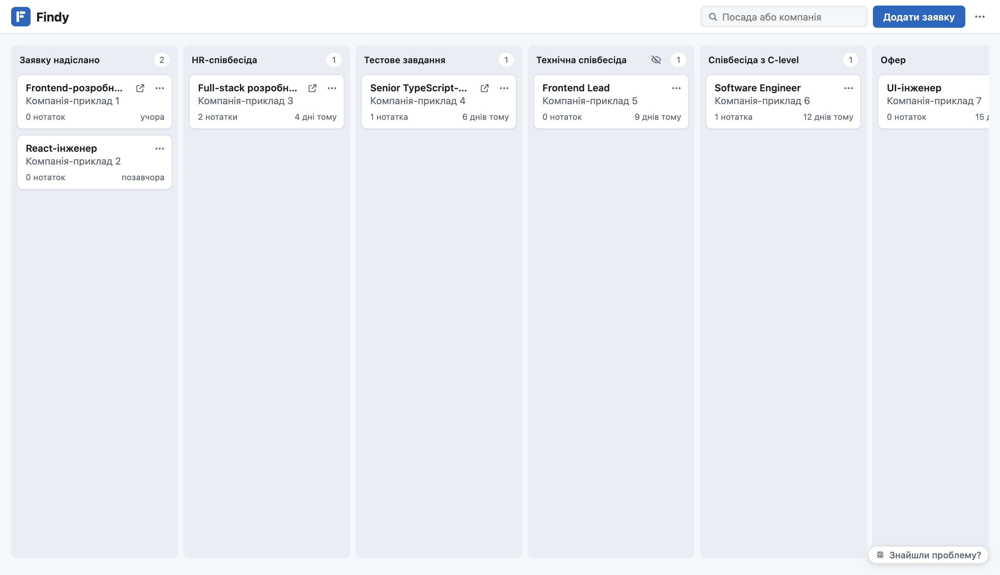
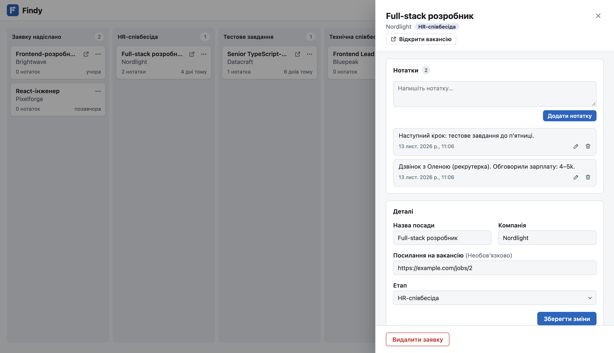

<p align="center"></p>

# Findy

**Безкоштовний десктопний застосунок з відкритим кодом для відстеження пошуку роботи.**

[English](README.md)

> **Статус: 0.1.0, перший реліз.** Завантажити можна на сторінці
> [Releases](https://github.com/YuraBerez/findy/releases). Будемо раді відгукам: кнопка
> *Знайшли проблему?* у застосунку.

Надсилаєте десятки резюме й забуваєте, з якою компанією на якому ви етапі?
Findy збирає всі заявки на одній дошці: від відгуку на вакансію до оферу.





## Можливості

- **Канбан-дошка пошуку роботи.** Кожна заявка — це картка, а колонки — етапи
  найму:

  `Заявку надіслано` → `HR-співбесіда` → `Тестове завдання` →
  `Технічна співбесіда` → `Співбесіда з C-level` → `Офер` / `Відмова`

- **Швидке додавання:** назва позиції, компанія й посилання на вакансію.
- **Перетягування карток** між етапами (з клавіатури теж можна).
- **Нотатки до кожної заявки:** з ким говорили, яку зарплату обговорювали, що далі.
- **Вакансія в один клік:** картка з посиланням відкриває його в браузері.
- **Панель деталей:** редагування заявки та історія етапів у вигляді таймлайну.
- **Історія етапів:** на картці видно, скільки часу заявка на поточному етапі.
- Інтерфейс **українською та англійською**, **світла й темна** тема.
- **Почати спочатку:** очищення дошки в один крок, перед цим Findy робить резервну копію.
- **Приватність.** Працює офлайн, без акаунта й без телеметрії. Дані зберігаються
  в локальній базі SQLite на вашому комп'ютері.
- **Windows, macOS і Linux.**

## Завантаження

Інсталятори на сторінці [Releases](https://github.com/YuraBerez/findy/releases):

| ОС | Файл |
|----|------|
| Windows 10/11 (x64) | `Findy-Setup-x.y.z.exe` |
| macOS (Apple Silicon) | `Findy-x.y.z-arm64.dmg` |
| macOS (Intel) | `Findy-x.y.z-x64.dmg` |
| Linux (x64) | `Findy-x.y.z.AppImage` або `findy_x.y.z_amd64.deb` |

Перші збірки не підписані:

- **macOS:** правий клік на застосунку → *Відкрити*, або
  `xattr -dr com.apple.quarantine /Applications/Findy.app`.
- **Windows:** у вікні SmartScreen натисніть *Докладніше* → *Усе одно запустити*.
- **Linux (AppImage):** `chmod +x Findy-*.AppImage` і запустіть файл.

## Запуск із вихідного коду

Потрібно: [Node.js](https://nodejs.org/) 22 LTS або новіший, npm, Git.

```bash
git clone https://github.com/YuraBerez/findy.git
cd findy
npm install
npm run dev          # запуск із гарячим перезавантаженням
```

Інші команди:

| Команда | Що робить |
|---------|-----------|
| `npm run build` | Продакшн-збірка коду застосунку |
| `npm run dist` | Інсталятор для вашої ОС у `dist/` |
| `npm test` | Unit-тести |
| `npm run test:coverage` | Unit-тести з перевіркою покриття ≥ 80 % |
| `npm run test:e2e` | End-to-end тести на реальному застосунку |
| `npm run lint` | Лінтер і перевірка типів |

На Linux можуть знадобитися стандартні системні бібліотеки Electron
(`libgtk-3-0 libnss3 libasound2`), а для збірки `.deb` ще `fakeroot` і `dpkg`.

## Findy з Claude чи іншим AI-асистентом (MCP)

У Findy вбудований [MCP](https://modelcontextprotocol.io)-сервер: асистент може
додавати, переміщувати й коментувати заявки на ваше прохання («я відгукнувся в Acme
на фронтенд», «перемісти Globex на технічну співбесіду»).

1. У Findy відкрийте **⋯ → Доступ для AI-асистентів (MCP)…** і ввімкніть його (за замовчуванням вимкнено).
2. Скопіюйте показані налаштування у свій клієнт:
   - **Claude Desktop / Cowork:** `claude_desktop_config.json` (Settings → Developer → Edit Config).
   - **Claude Code:** команда `claude mcp add findy …` з того самого діалогу.
   - **Gemini CLI, Cursor, VS Code, Windsurf, Zed, Codex CLI…:** команда, аргументи
     й змінна середовища (`ELECTRON_RUN_AS_NODE=1`) з діалогу, транспорт stdio.
     Коротка форма `<Findy> --mcp` теж працює.

Інструменти: список і перегляд заявок, список етапів, додати, змінити, перемістити,
нотатка, видалити (асистент спершу питає вас). Правила ті самі, що в застосунку, а
відкрите вікно Findy показує зміни протягом секунди.

**Приватність:** сам Findy не робить мережевих запитів. Підключений асистент передає
прочитане своєму AI-провайдеру — лише коли ви просите його попрацювати з дошкою.

## Де мої дані?

| ОС | Шлях |
|----|------|
| Windows | `%APPDATA%\Findy\findy.db` |
| macOS | `~/Library/Application Support/Findy/findy.db` |
| Linux | `~/.config/Findy/findy.db` |

Це звичайна база SQLite: для збереження дошки зробіть резервну копію файлу,
а переглянути дані можна будь-яким SQLite-інструментом. Схему описано в
[docs/contracts/database.md](docs/contracts/database.md).

## Долучитися

Будемо раді коду, перекладам, баг-репортам та ідеям. Почніть із
[CONTRIBUTING.md](CONTRIBUTING.md).

## Ліцензія

[MIT](LICENSE)
