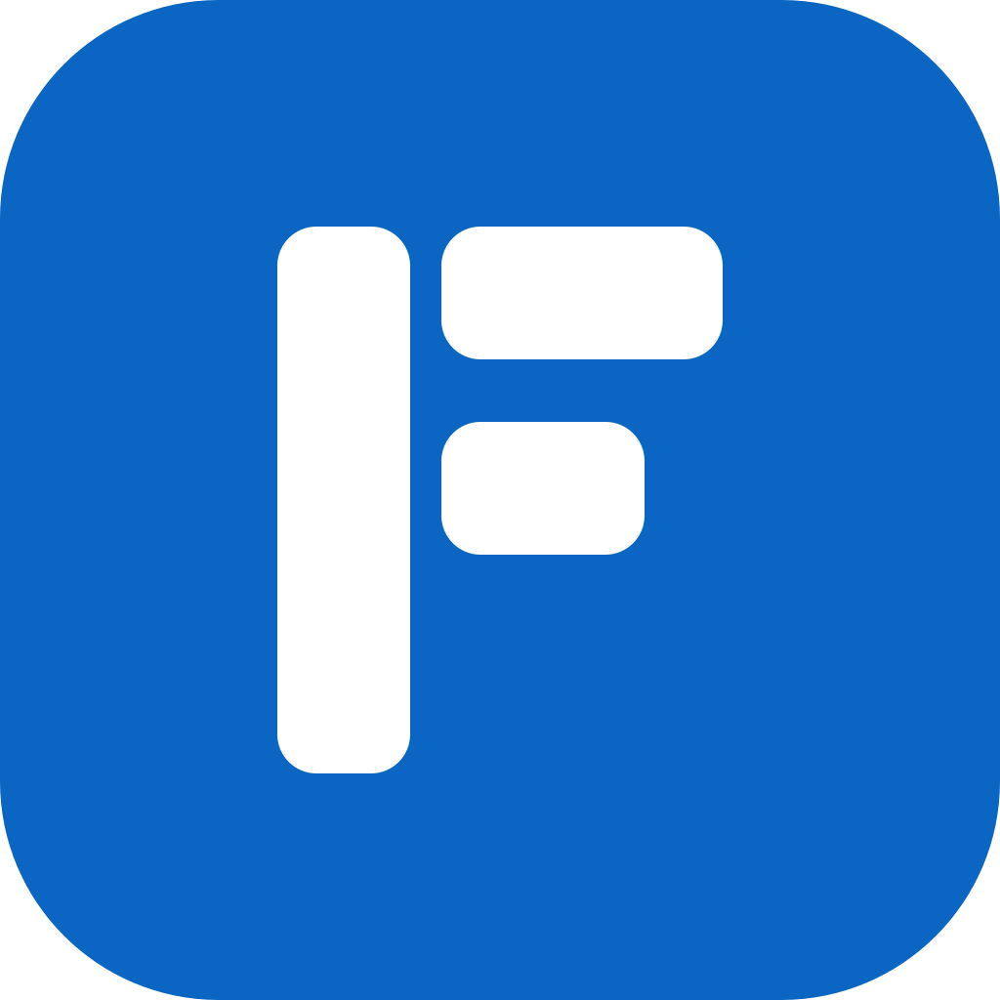
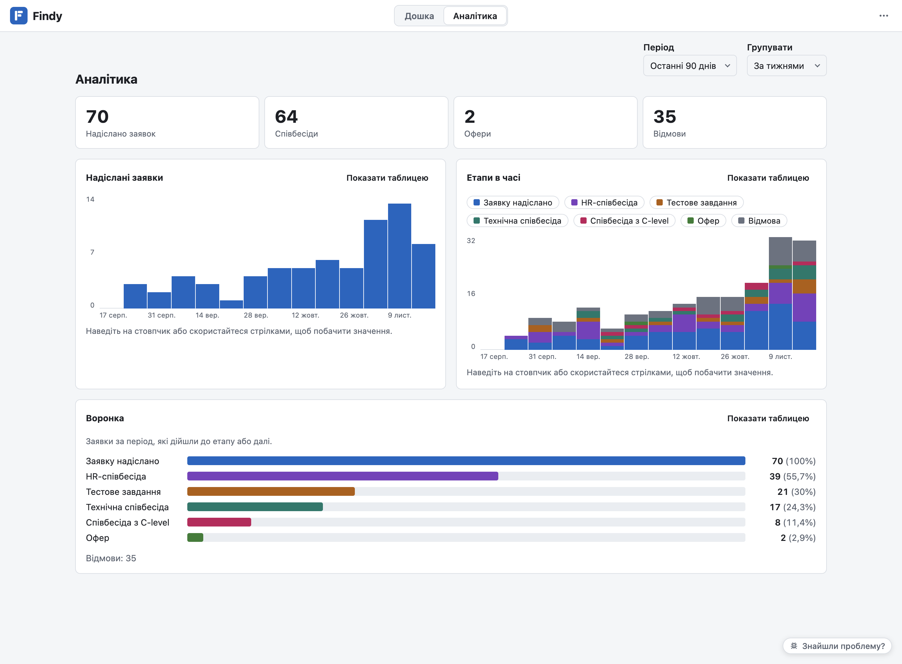
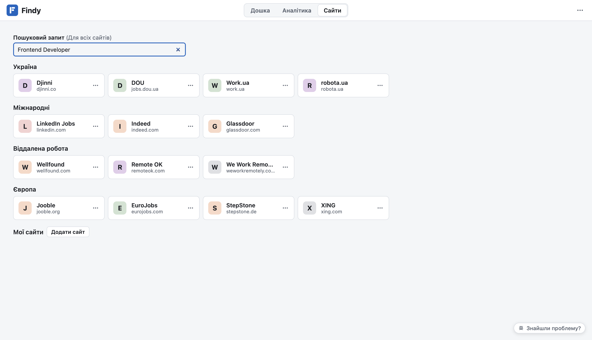

<p align="center"></p>

# Findy

**Безкоштовний десктопний застосунок з відкритим кодом для відстеження пошуку роботи.**

**Сайт:** [yuraberez.github.io/Findy/uk](https://yuraberez.github.io/Findy/uk/)

[English](README.md)

[](https://ko-fi.com/findyapp)

> **Статус: 0.7.0.** Завантажити можна на сторінці
> [Releases](https://github.com/YuraBerez/findy/releases). Будемо раді відгукам: кнопка
> *Знайшли проблему?* у застосунку.

Надсилаєте десятки резюме й забуваєте, з якою компанією на якому ви етапі?
Findy збирає всі заявки на одній дошці: від відгуку на вакансію до оферу.

[](https://www.youtube.com/watch?v=6CEthFABoIE)






## Можливості

- **Канбан-дошка пошуку роботи.** Кожна заявка — це картка, а колонки — етапи
  найму:

  `Заявку надіслано` → `HR-співбесіда` → `Тестове завдання` →
  `Технічна співбесіда` → `Співбесіда з C-level` → `Офер` / `Відмова`

- **Швидке додавання:** назва позиції, компанія й посилання на вакансію.
- **Перетягування карток** між етапами (з клавіатури теж можна).
- **Нотатки до кожної заявки:** з ким говорили, яку зарплату обговорювали, що далі.
- **Зарплата, формат роботи й контакт:** вилка зарплати, віддалено/офіс/гібрид, локація,
  джерело вакансії та рекрутер у кожній заявці. Картка показує формат і зарплату, а
  джерело заповнюється саме з посилання на сайт вакансій.
- **Наступний крок і нагадування:** додайте до заявки наступний крок із датою й часом.
  Картка показує «Сьогодні», «Завтра» або «Прострочено». Поки Findy відкрита, вона
  нагадає за 15 хвилин і за 1 хвилину до кроку. **Додати в календар** зберігає крок як
  файл `.ics`. На macOS дозвольте сповіщення для Findy в **Системних параметрах →
  Сповіщення**.
- **Вакансія в один клік:** картка з посиланням відкриває його в браузері.
- **Додавання з посилання:** вставте посилання на вакансію, і Findy заповнить посаду
  й компанію зі сторінки.
- **Додавання з браузера:** розширення Findy для браузера додає відкриту вакансію в один
  клік, навіть зі сторінок за логіном ([як встановити](docs/guide/browser-extension.uk.md)).
- **Кольори карток:** позначте картку одним із 7 кольорів у її меню **⋯**.
- **Без руху:** картки, що стоять на етапі довше 14 днів (кількість днів можна змінити),
  позначені, тож видно, кому варто нагадати про себе.
- **Панель деталей:** редагування заявки та історія етапів у вигляді таймлайну.
- **Історія етапів:** на картці видно, скільки часу заявка на поточному етапі.
- **Аналітика:** скільки заявок ви надсилаєте за день, тиждень чи місяць, скільки було
  HR-, технічних і C-level співбесід, і як далеко заходять заявки у воронці. Кожен
  графік можна показати таблицею.
- **Перевірка оновлень:** **⋯ → Перевірити оновлення…** скаже, коли вийде нова версія.
  Автоматичну перевірку можна ввімкнути в **⋯ → Налаштування…** (за замовчуванням вимкнена).
- **Сайти вакансій:** вкладка **Сайти** з 14 сайтами (Djinni, DOU, Work.ua, LinkedIn,
  Indeed та інші): введіть запит один раз і відкрийте його на будь-якому сайті одним
  кліком. Додавайте власні сайти й ховайте непотрібні.
- Інтерфейс **українською та англійською**, **світла й темна** тема.
- **Експорт та імпорт CSV:** збережіть усю дошку у файл, який відкривається в будь-якій
  таблиці, або додайте заявки з власної таблиці (**⋯ → Експорт у CSV…**,
  **Імпорт із CSV…**). Імпорт спершу показує підсумок і не змінює наявних карток.
- **Почати спочатку:** очищення дошки в один крок, перед цим Findy робить резервну копію.
- **Одне вікно налаштувань:** **⋯ → Налаштування…** або Cmd/Ctrl+, відкриває мову, тему,
  колонки, нагадування, перевірку оновлень і доступ для AI-асистента в одному місці.
- **Приватність.** Працює офлайн, без акаунта й без телеметрії. Дані зберігаються
  в локальній базі SQLite на вашому комп'ютері. В інтернет Findy звертається лише на
  ваше прохання: перевірка оновлень (коли ви її запустили чи ввімкнули), сторінка
  вакансії, посилання на яку ви вставили, та іконки сайтів вакансій (один раз для
  кожного). Жоден із цих запитів не передає даних про вас чи вашу дошку.
- **Windows, macOS і Linux.**

## Завантаження

Інсталятори на сторінці [Releases](https://github.com/YuraBerez/findy/releases):

| ОС | Файл |
|----|------|
| Windows 10/11 (x64) | `Findy-Setup-x.y.z.exe` |
| Mac з Apple Silicon (M1, M2, M3, M4…) | `Findy-x.y.z-macOS-Apple-Silicon.dmg` |
| Mac з процесором Intel | `Findy-x.y.z-macOS-Intel.dmg` |
| Windows, портативна версія (без встановлення) | `Findy-x.y.z-Windows-portable.zip` |
| Linux (x64) | `Findy-x.y.z.AppImage` або `findy_x.y.z_amd64.deb` |

Findy потребує macOS 13 Ventura чи новішої або Windows 10/11 (64-біт).

Homebrew, Scoop, перевірка завантаження й перший запуск (збірки поки не підписані):
[docs/guide/install.uk.md](docs/guide/install.uk.md).

## Запуск із вихідного коду

Див. [CONTRIBUTING.md](CONTRIBUTING.md#development-setup) (англійською).

## Додати вакансію з браузера

Розширення Findy для браузера додає вакансію, яку ви бачите, на дошку в один клік —
навіть зі сторінок за логіном. У магазинах браузерів його поки немає: як встановити його
з релізу й підключити в Chrome, Edge, Brave, Opera, Vivaldi чи Firefox — у
[docs/guide/browser-extension.uk.md](docs/guide/browser-extension.uk.md).

## Findy з Claude чи іншим AI-асистентом (MCP)

У Findy вбудований [MCP](https://modelcontextprotocol.io)-сервер: асистент може
додавати, переміщувати й коментувати заявки на ваше прохання («я відгукнувся в Acme на
фронтенд»). Доступ вимкнено, доки ви не ввімкнете його в **⋯ → Налаштування… →
AI-асистент**. Як підключити клієнт:
[docs/guide/ai-assistant.uk.md](docs/guide/ai-assistant.uk.md).

## Встановити скіл Findy

Скіл навчає асистента працювати з вашою дошкою. Claude Code встановлює його однією
командою; кроки для Claude Desktop та інших асистентів — у
[docs/guide/ai-assistant.uk.md](docs/guide/ai-assistant.uk.md#встановити-скіл-findy).

macOS і Linux:

```bash
mkdir -p ~/.claude/skills/findy && curl -fsSL "https://raw.githubusercontent.com/YuraBerez/Findy/main/skills/findy/SKILL.md" -o ~/.claude/skills/findy/SKILL.md.tmp && mv ~/.claude/skills/findy/SKILL.md.tmp ~/.claude/skills/findy/SKILL.md
```

Windows (PowerShell):

```powershell
$d = "$HOME\.claude\skills\findy"; New-Item -ItemType Directory -Force $d | Out-Null; Invoke-WebRequest -UseBasicParsing "https://raw.githubusercontent.com/YuraBerez/Findy/main/skills/findy/SKILL.md" -OutFile "$d\SKILL.md.tmp"; if ($?) { Move-Item -Force "$d\SKILL.md.tmp" "$d\SKILL.md" }
```

## Де мої дані?

| ОС | Шлях |
|----|------|
| Windows | `%APPDATA%\Findy\findy.db` |
| macOS | `~/Library/Application Support/Findy/findy.db` |
| Linux | `~/.config/Findy/findy.db` |

Це звичайна база SQLite: для збереження дошки зробіть резервну копію файлу,
а переглянути дані можна будь-яким SQLite-інструментом. Щоб отримати заявки у вигляді
таблиці, скористайтеся **⋯ → Експорт у CSV…**. Схему описано в
[docs/contracts/database.md](docs/contracts/database.md).

## Підтримати Findy

Findy безкоштовний і таким залишиться. Збірки для macOS ще не нотаризовані: для цього
потрібне членство Apple Developer ($99 на рік), тому macOS один раз питає під час першого
запуску. Якщо Findy допомагає вам у пошуку роботи, можете
[підтримати його на Ko-fi](https://ko-fi.com/findyapp): перша ціль — саме це
членство, щоб Findy відкривався на Mac без попередження.

## Долучитися

Будемо раді коду, перекладам, баг-репортам та ідеям. Почніть із
[CONTRIBUTING.md](CONTRIBUTING.md).

## Ліцензія

[MIT](LICENSE)
