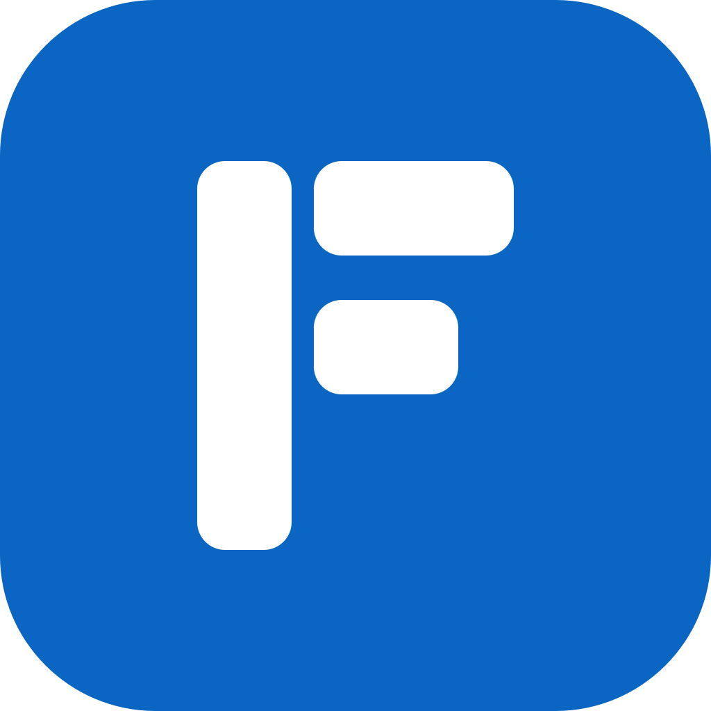

# Brand

## Logo

The logo is a white letter **F** on a blue rounded square. The F is made of kanban
cards: one tall column and two cards. This shows the board that the app is about.

| File | Use |
|------|-----|
| `assets/logo.svg` | Source of truth. README, docs, full-bleed icons (Windows, Linux) |
| `build/icon-macos.svg` | macOS variant on the Apple icon grid (824 px body on a 1024 px canvas) |
| `build/icon.png` | 1024 px, Linux and fallback (generated) |
| `build/icon.icns` | macOS, 16–1024 px (generated) |
| `build/icon.ico` | Windows, 16–256 px (generated) |

Do not edit the generated files by hand. Change the SVG, then generate them again.
Do not add effects (gradients, shadows) to the mark: it must stay readable at 16 px.

## Colours

| Token | Light | Dark | Use |
|-------|-------|------|-----|
| `--primary` | `#0A66C2` | `#4A9DE8` | Logo, primary buttons, focus rings, links |
| `--on-primary` | `#FFFFFF` | `#FFFFFF` | Text and icons on `--primary` |

The dark-theme primary is lighter, so it keeps enough contrast on the dark background.
Tokens live in `src/renderer/styles/global.css`.

Findy is not affiliated with any job platform. Do not use other companies' logos or
names in the Findy brand.
